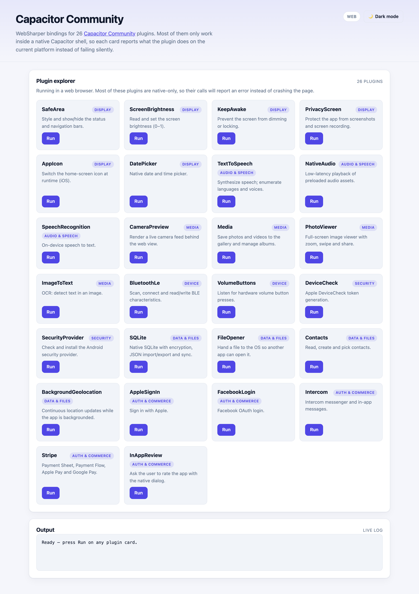

# WebSharper Capacitor Community

[](https://www.nuget.org/packages/WebSharper.Capacitor.Community)

WebSharper bindings for the [Capacitor Community](https://github.com/capacitor-community)
plugin collection, extending [WebSharper Capacitor](https://github.com/dotnet-websharper/Capacitor).

## Repository structure

| Project | Description |
|---|---|
| `WebSharper.Capacitor.Community` | The binding. `Main.fs` builds the WIG code model; `netstandard2.0`. |
| `WebSharper.Capacitor.Community.Sample` | Capacitor + Vite sample exercising all 26 plugins; `net10.0`. |

## Live demos

**Try it live:** [Open the sample in your browser](https://dotnet-websharper.github.io/Capacitor.Community/)



The sample doubles as the binding's [test case](#running-the-test-case): it renders one card
per bound plugin and calls the plugin API when you press **Run**, reporting either the result
or why the plugin is unavailable.

Also see the [source](https://github.com/dotnet-websharper/Capacitor.Community) and the
[WebSharper plugin catalog](https://websharper.com/plugins).

## Bound plugins

All plugins are tracked at their **current npm release**, so the packages are pinned to
`>= <release> < <next major>` in the binding's `.fsproj`.

| Plugin | npm | Notes |
|---|---|---|
| AppIcon | `@capacitor-community/app-icon` 7.0.0 | |
| AppleSignIn | `@capacitor-community/apple-sign-in` 7.1.0 | upstream still targets Capacitor 7 |
| BackgroundGeolocation | `@capacitor-community/background-geolocation` 1.3.1 | types-only package; registered via `Capacitor.registerPlugin` |
| BluetoothLe | `@capacitor-community/bluetooth-le` 8.3.0 | |
| CameraPreview | `@capacitor-community/camera-preview` 8.0.2 | |
| Contacts | `@capacitor-community/contacts` 8.0.0 | |
| DatePicker | `@capacitor-community/date-picker` 7.1.0 | upstream still targets Capacitor 7 |
| DeviceCheck | `@capacitor-community/device-check` 8.0.0 | |
| FacebookLogin | `@capacitor-community/facebook-login` 8.1.0 | |
| FileOpener | `@capacitor-community/file-opener` 8.0.1 | |
| ImageToText | `@capacitor-community/image-to-text` 8.0.0 | exported as `Ocr` |
| InAppReview | `@capacitor-community/in-app-review` 8.0.0 | |
| Intercom | `@capacitor-community/intercom` 8.0.0 | |
| KeepAwake | `@capacitor-community/keep-awake` 8.0.1 | |
| Media | `@capacitor-community/media` 9.1.0 | own `9.x` version line |
| NativeAudio | `@capacitor-community/native-audio` 8.0.0 | |
| PhotoViewer | `@capacitor-community/photoviewer` 8.0.1 | |
| PrivacyScreen | `@capacitor-community/privacy-screen` 8.0.0 | |
| SafeArea | `@capacitor-community/safe-area` 8.0.1 | `enable`/`disable` removed upstream |
| ScreenBrightness | `@capacitor-community/screen-brightness` 8.0.0 | |
| SecurityProvider | `@capacitor-community/security-provider` 7.0.0 | exported as `CapacitorSecurityProvider`; upstream still targets Capacitor 7 |
| SpeechRecognition | `@capacitor-community/speech-recognition` 7.0.1 | upstream still targets Capacitor 7 |
| SQLite | `@capacitor-community/sqlite` 8.1.1 | exported as `CapacitorSQLite` |
| Stripe | `@capacitor-community/stripe` 8.3.0 | |
| TextToSpeech | `@capacitor-community/text-to-speech` 8.0.2 | |
| VolumeButtons | `@capacitor-community/volume-buttons` 8.0.1 | |

## Install

```sh
dotnet add package WebSharper.Capacitor.Community
```

The package depends on `WebSharper.Capacitor`, which provides the Capacitor core bindings:

```sh
dotnet add package WebSharper.Capacitor
```

Install the npm plugin you want to use in your Capacitor app. For example:

```sh
npm i @capacitor-community/bluetooth-le
npx cap sync
```

The binding's `<NpmDependencies>` already records the supported range, so a WebSharper
build emits the matching npm dependency for you.

## Usage

```fsharp
open WebSharper.Capacitor.Community

let brightness () =
    promise {
        let! current = CapacitorCommunity.ScreenBrightness.GetBrightness()
        do! CapacitorCommunity.ScreenBrightness.SetBrightness(
                ScreenBrightness.SetBrightnessOptions(Brightness = 1.0))
        return current.Brightness
    }
```

Plugin instances hang off `CapacitorCommunity`, and their option/result types live in a
per-plugin namespace (`ScreenBrightness`, `BluetoothLe`, `Stripe`, …):

```fsharp
let scan () =
    promise {
        do! CapacitorCommunity.BluetoothLe.Initialize()
        let! enabled = CapacitorCommunity.BluetoothLe.IsEnabled()
        let! bonded = CapacitorCommunity.BluetoothLe.GetBondedDevices()
        return enabled.Value, bonded.Devices.Length
    }
```

## Notes on the API

- **Most plugins are native-only.** They reject in a plain browser. The sample catches that
  and reports it; your app should do the same (or gate calls on
  `Capacitor.isNativePlatform()`).
- **`SafeArea` changed shape.** Upstream removed `enable`/`disable` in favor of
  `setSystemBarsStyle`, `showSystemBars` and `hideSystemBars`. The old members are kept as
  `Obsolete` aliases that forward to the new ones.
- **`BluetoothLe` is options-object based.** v8 replaced the positional parameters of
  `connect`, `read`, `write`, `isBonded`, `getMtu`, `readRssi` and friends with option
  records, and wrapped several returns (`GetDevicesResult`, `GetMtuResult`, `ReadResult`,
  …). Positional call sites from earlier versions need updating.
- **Return shapes are typed.** `CameraPreview.Capture` returns `{ value }`,
  `NativeAudio.GetDuration` returns `{ duration }`, `TextToSpeech.IsLanguageSupported`
  takes `{ lang }` and returns `{ supported }`.
- **`BackgroundGeolocation` ships no JavaScript.** The package only carries typings; the
  binding registers the plugin through `Capacitor.registerPlugin("BackgroundGeolocation")`.
- **Export names differ from the plugin names.** `SQLite` is exported as
  `CapacitorSQLite`, `SecurityProvider` as `CapacitorSecurityProvider`, `ImageToText` as
  `Ocr`, and `AppleSignIn` as `SignInWithApple`. The binding handles the mapping.

## Running the test case

```sh
cd WebSharper.Capacitor.Community.Sample
npm install
dotnet build -c Release
npx vite build
dotnet serve -d wwwroot/dist -p 8080
```

Open <http://localhost:8080>. Most cards report "plugin is not implemented on web" — that is
the expected graceful degradation. To exercise the native implementations:

```sh
npx cap sync
npx cap run android    # or: npx cap run ios
```

## Build from source

```sh
dotnet tool restore
dotnet paket restore
dotnet build -c Release
```

The binding and sample build on .NET 10; the WebSharper 11 compiler needs the .NET 11
runtime.

## Pack

```sh
dotnet fsi ./build.fsx -t WS-Package
```

The nupkg contains the binding assembly, its XML docs and the `.websharper` metadata
sidecar.

## Deployment

The `ghpages.yml` workflow builds the sample with Paket and publishes `wwwroot/dist` to the
`gh-pages` branch on every push to `main`.

## License

Apache 2.0 — see [LICENSE.md](LICENSE.md).